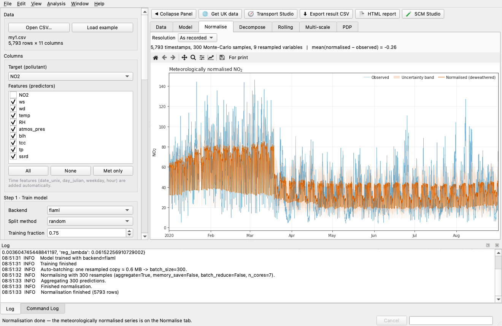

# normet

**Normalisation, Decomposition, and Counterfactual Modelling for Environmental Time-series**

[](https://pypi.org/project/normet/)
[](https://www.python.org/)
[](LICENSE)
[](https://github.com/apai-sys/normet-py/actions)
[](https://github.com/apai-sys/normet-py/actions/workflows/build-gui.yml)
[](https://normet.readthedocs.io)

`normet` is a Python package for **deweathering**, **causal inference**, and **policy evaluation** on environmental time-series data. It wraps AutoML model training, Monte Carlo meteorological normalisation, and Synthetic Control Methods behind a clean, high-level API — so you spend time on science, not boilerplate.

`normet` brings together three ideas behind one API:

1. **AutoML model training** (FLAML or LightGBM) learns how a pollutant
   concentration depends on meteorology, time, and other predictors.
2. **Monte Carlo meteorological normalisation ("deweathering")** re-runs that model
   thousands of times against resampled, randomised meteorology to cancel out
   day-to-day meteorological noise and reveal the underlying emission-driven trend.
3. **Synthetic Control Methods (SCM)** answer "what would have happened
   without this policy?" by building a counterfactual from untreated donor
   units, with placebo tests and uncertainty bands.

Zero-shot de-weathering with the Chronos-2 foundation model, data adapters, a CLI, an
MCP server for AI assistants and a desktop app build on the same API.



---

## Core capabilities

| Module | What it does |
|---|---|
| `nm.prepare_data` | Imputation, date-feature engineering, train/test splitting |
| `nm.train_model` / `nm.build_model` | AutoML via FLAML or tuned LightGBM |
| `nm.normalise` | Monte Carlo meteorological normalisation (deweathering) |
| `nm.decompose` | Split time series into emission-driven and met-driven components |
| `nm.rolling` | Rolling-window normalisation for trend analysis |
| `nm.run_scm` / `nm.scm` | Synthetic Control Method (classic, augmented ridge); several treated units each with its own cutoff via `nm.run_scm_staggered` (staggered adoption: per-unit effects and placebo p-values, plus the pooled mean/median with a cross-unit permutation test — rolling-out schemes such as the UK ULEZ expansion) |
| `nm.mlscm` | ML-augmented SCM (**experimental** — see [Synthetic control](https://normet.readthedocs.io/en/latest/guide/examples_scm_guide.html)) |
| `nm.placebo_in_space` / `nm.placebo_in_time` | Placebo significance tests |
| `nm.uncertainty_bands` | Bootstrap / Jackknife confidence intervals |
| `nm.do_all` | End-to-end pipeline in one call |
| `nm.do_all_unc` | End-to-end pipeline with model-ensemble uncertainty bands |
| `nm.do_all_multisite` | Parallel per-site pipelines |
| `nm.pdp` | Partial dependence plots |
| `nm.modStats` | Model performance metrics (R², RMSE, MAE, …) |
| `nm.trend` / `nm.mann_kendall` / `nm.theil_sen` / `nm.detect_trend_breaks` | Trend analyses with the block-bootstrap correction for autocorrelated records, plus the segmented (piecewise) trend for records whose level or slope changes part-way through |
| `nm.crps_from_quantiles` / `nm.crps_from_samples` / `nm.pinball_loss` / `nm.crps_observed` | Probabilistic skill scores (Gneiting & Raftery 2005): CRPS for quantile and ensemble forecasts, the pinball loss, and a point forecast's CRPS reference |
| `nm.decompose_uncertainty` | Attribute a de-weathered estimate's total spread to its source — weather (met resampling) vs model form vs their interaction — via an additive per-date variance decomposition |
| `nm.detect_events` / `nm.anomaly_scores` | Event detection on normalised residuals |
| `nm.normalise_plot` / `nm.decomposition_stack` / `nm.scm_dashboard` | Plotting helpers for normalisation, decomposition, and SCM results |
| `nm.bayesian_scm` / `nm.plot_bayesian_scm` | Bayesian (PyMC) posterior SCM with credible bands — **optional**, needs `pymc` + `arviz` |
| `nm.scm_diagnostics` / `nm.pre_trend_test` / `nm.plot_event_study` / `nm.loo_weight_stability` / `nm.conformal_effect_interval` | SCM fit diagnostics, pre-period parallel-trends test and its event-study figure, donor-weight stability, conformal intervals |
| `nm.donor_spatial_summary` / `nm.spatial_summary` | Where the donor pool sits around the treated unit: per-donor distance, compass bearing and sector, the pool's centroid offset and sector coverage (a reading, not a fit input) |
| `nm.Chronos2Estimator` | Zero-shot de-weathering, counterfactuals and quantiles with the Chronos-2 foundation model — **optional**, needs `normet[foundation]` |
| `nm.normalise_in_context` / `Chronos2Estimator.normalise_in_context` | In-Context Normalisation (ICN): future-only intervention (D1) over a configurable meteorology pool (D2) that preserves short emission events `deweather` absorbs. Returns level + paired estimates with the anchor/Monte-Carlo spread split — **optional**, needs `normet[foundation]` |
| `nm.calibrate_quantiles` | Quantile calibration for the zero-shot band: per-level conformal half-width thresholds on a rolling hold-out of forecast blocks, with a cross-validated coverage table; `counterfactual(..., calibrated=True)` takes the band through it — **optional**, needs `normet[foundation]` |
| `nm.ChronosEmbedder` | 768-D station embeddings describing each site's dynamics — **optional**, needs `normet[foundation]` |
| `nm.silhouette_curve` / `nm.embedding_projection` / `nm.plot_embedding_diagnostics` | Diagnostics for choosing how to use site embeddings — the silhouette against the number of groups, a 2-D projection, and the two-panel figure. No cluster labels, no recommended k — **optional**, needs `scikit-learn` for the curve |
| `nm.make_run` / `nm.save_run` / `nm.generate_html_report` | Provenance tracking and auto-generated HTML/Markdown run reports |
| `nm.make_memory` | On-disk caching for expensive pipelines |
| `normet.io` | ERA5, EEA, OpenAQ, UK air-quality network data adapters |

---

## Installation

```bash
pip install "normet[flaml]"     # with the recommended AutoML backend
```

`normet` needs at least one model backend; the core package installs only `numpy`,
`pandas`, `scipy`, `scikit-learn`, `joblib` and `matplotlib`. Other optional features
come as extras, which combine (`pip install "normet[gui,flaml]"`):

| Extra | For |
|---|---|
| `flaml` / `lgb` | AutoML (FLAML, recommended) or the lightweight LightGBM tuner |
| `data` | ERA5 / EEA / OpenAQ / UK air quality (ukaq) data adapters |
| `foundation` | Chronos-2 foundation model (zero-shot de-weathering, station embeddings) |
| `cli` | The `normet` command-line tool |
| `mcp` | MCP server for AI assistants (Claude Code, Claude Desktop, ...) |
| `gui` | The desktop app (`normet-gui`) |
| `all` | Everything |

The development version, which the documentation tracks:

```bash
pip install git+https://github.com/apai-sys/normet-py.git
```

**Desktop app.** `pip install "normet[gui,flaml]"`, then run `normet-gui`. Ready-made
installers — `.dmg` (macOS), `.exe` (Windows), `.AppImage` (Linux) — are built by the
[`build-gui.yml`](.github/workflows/build-gui.yml) workflow (**Actions → Artifacts**);
see [`packaging/README.md`](packaging/README.md) to build one locally.

The [installation guide](https://normet.readthedocs.io/en/latest/getting_started/installation.html)
lists every extra and its dependencies.

---

## Quick start

`nm.do_all` runs the full pipeline — prepare → train → normalise — in a single
call. The example uses `normet`'s bundled real-world dataset: hourly NO2 and
ERA5 meteorology at London Marylebone Road (MY1), January–August 2020 — a
window spanning the UK COVID-19 lockdown:

```python
import normet as nm

df = nm.datasets.load_my1()

# Meteorological predictors + time features the model will see
met_vars = ["ws", "wd", "temp", "RH", "atmos_pres", "blh", "tcc", "tp", "ssrd"]
predictors = met_vars + ["date_unix", "day_julian", "weekday", "hour"]

out, model, df_prep = nm.do_all(
    df=df,
    target="NO2",
    backend="flaml",          # or "lightgbm"
    covariates=predictors,
    variables_resample=met_vars,  # resample met only — not time features
    n_samples=300,
    n_cores=4,                # parallelise resampling
)

print(out.head())
nm.modStats(df_prep, model)
```

`do_all` returns a 3-tuple: `(normalised_df, model, prepared_df)`. The
[step-by-step workflow](https://normet.readthedocs.io/en/latest/guide/workflow.html)
takes it apart and continues into decomposition and synthetic control.

---

## Documentation

The full documentation is at **[normet.readthedocs.io](https://normet.readthedocs.io)**:

- **Getting started** — [installation](https://normet.readthedocs.io/en/latest/getting_started/installation.html)
  and [quick start](https://normet.readthedocs.io/en/latest/getting_started/quickstart.html),
  including the bundled example datasets.
- **User guide** — the [step-by-step workflow](https://normet.readthedocs.io/en/latest/guide/workflow.html),
  then [meteorological normalisation](https://normet.readthedocs.io/en/latest/guide/examples_normalisation.html),
  [zero-shot de-weathering with Chronos-2](https://normet.readthedocs.io/en/latest/guide/examples_foundation.html),
  [decomposition](https://normet.readthedocs.io/en/latest/guide/examples_decomposition.html),
  [trend analysis](https://normet.readthedocs.io/en/latest/guide/examples_trend.html),
  [synthetic control](https://normet.readthedocs.io/en/latest/guide/examples_scm_guide.html),
  [multisite pipelines](https://normet.readthedocs.io/en/latest/guide/examples_multisite.html),
  [caching](https://normet.readthedocs.io/en/latest/guide/examples_caching.html),
  [data adapters](https://normet.readthedocs.io/en/latest/guide/examples_data_adapters.html)
  and more.
- **Interfaces** — the [desktop GUI](https://normet.readthedocs.io/en/latest/guide/gui.html),
  the [command-line interface](https://normet.readthedocs.io/en/latest/guide/cli.html)
  and the [MCP server for AI assistants](https://normet.readthedocs.io/en/latest/guide/mcp.html).
- **[API reference](https://normet.readthedocs.io/en/latest/api.html)**, generated
  from the docstrings.
- **PDF user manuals** for the desktop app, in [English](docs/manual/normet_manual.pdf)
  and [Chinese](docs/manual/normet_manual_zh.pdf).
- **Notebooks** — [`notebooks/`](notebooks) reproduces each case study of the normet
  model-description paper end-to-end on the bundled data
  ([list](https://normet.readthedocs.io/en/latest/guide/notebooks.html)).

What changed in each release is in [CHANGELOG.md](CHANGELOG.md), and planned work in
the [roadmap](https://normet.readthedocs.io/en/latest/roadmap.html).

---

## How to cite

```bibtex
@Manual{normet-pkg,
  title        = {normet: Normalisation, Decomposition, and Counterfactual
                  Modelling for Environmental Time-series},
  author       = {Congbo Song and Contributors},
  year         = {2026},
  note         = {Python package version 1.0.0},
  organization = {University of Manchester},
  url          = {https://github.com/apai-sys/normet-py},
}
```

The same metadata is in [CITATION.cff](CITATION.cff), which GitHub's **Cite this
repository** button reads.

---

## Contributing

Contributions are welcome. Please open an issue or pull request on [GitHub](https://github.com/apai-sys/normet-py/issues), and see [CONTRIBUTING.md](CONTRIBUTING.md) for development setup and guidelines. Report security problems privately, as described in [SECURITY.md](SECURITY.md). Participation is governed by the [Code of Conduct](CODE_OF_CONDUCT.md).

## License

MIT — see [LICENSE](LICENSE).
