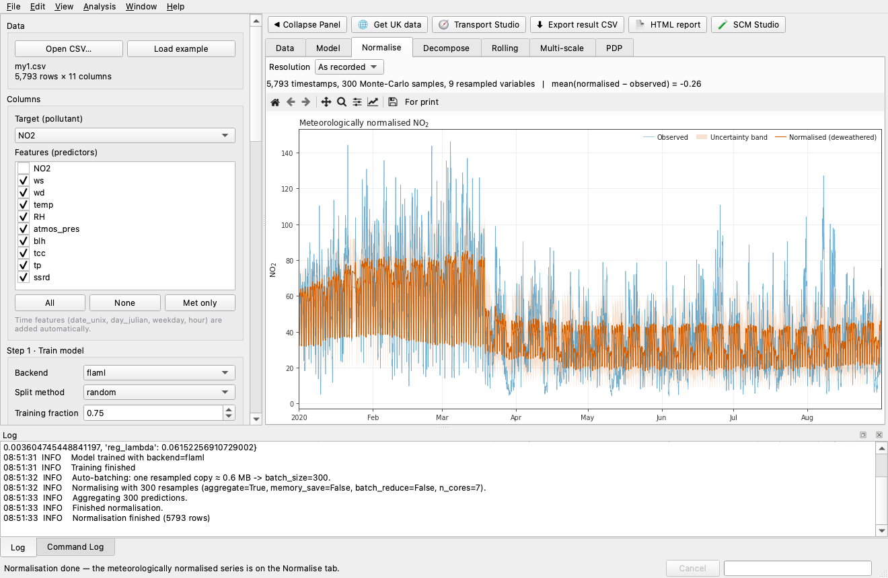
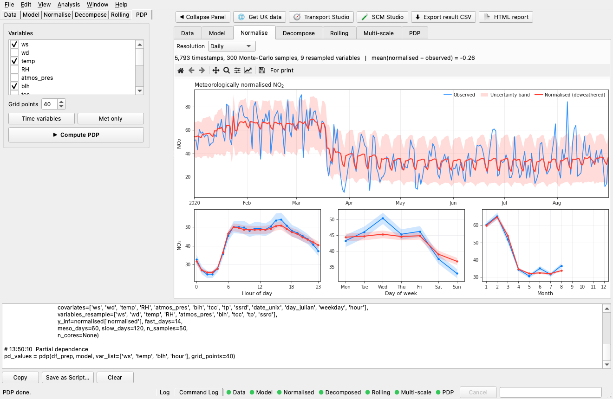
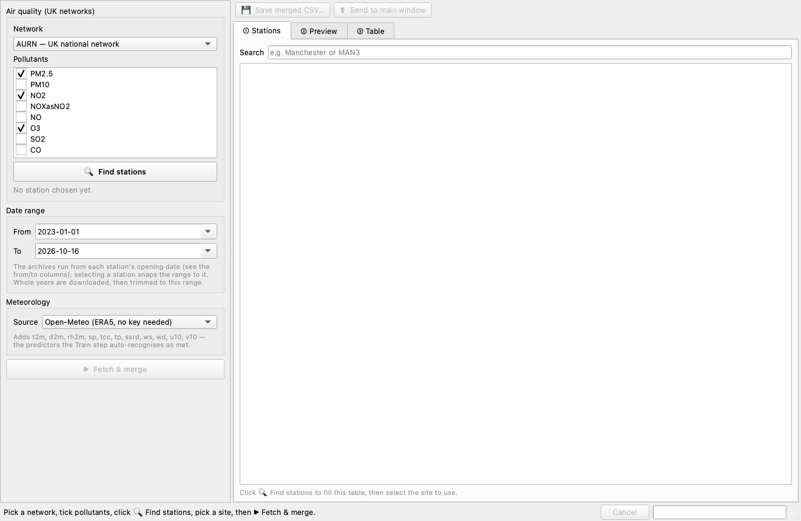
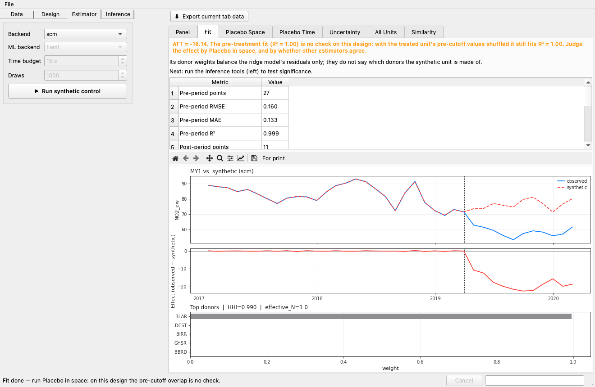
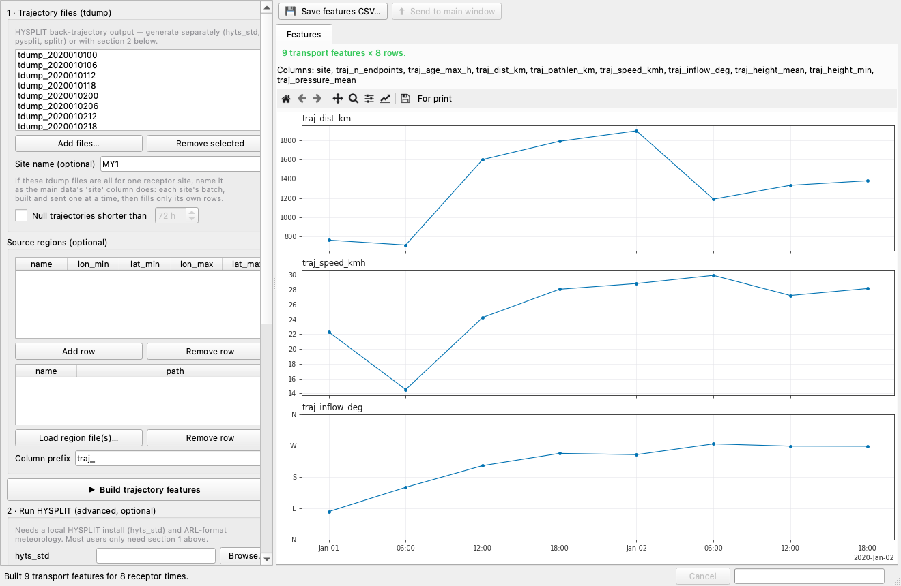

# Desktop GUI

A native Qt desktop app covers the full workflow without writing code, and
runs on macOS, Windows, and Linux.

**Install from PyPI:**

```bash
pip install "normet[gui,flaml]"   # or normet[gui,lgb]
normet-gui                        # optionally: normet-gui mydata.csv
```

**Or download a ready-made installer** — `.dmg` (macOS), `.exe` (Windows,
Inno Setup), `.AppImage` (Linux) — built by
[`build-gui.yml`](https://github.com/apai-sys/normet-py/actions/workflows/build-gui.yml)'s
3-OS matrix; grab the latest from the workflow's **Actions → Artifacts**, or
build one locally with `packaging/macos/build_dmg.sh` (macOS) or
`pyinstaller packaging/normet_gui.spec` (any OS — see
[`packaging/README.md`](https://github.com/apai-sys/normet-py/blob/main/packaging/README.md)).

The step-by-step manual with a screenshot of every panel is available as a PDF in
English and Chinese (see {ref}`pdf-manuals`).

## Main window



The meteorological-normalisation workflow as numbered steps in a left-hand
panel (Data → Columns → Train → Normalise → Decompose → Rolling → PDP), with
results in tabs that activate as each step finishes. The result tabs and the
status-bar step lights follow the workflow's order — Data, Model, Normalise,
Decompose, then the questions the decomposition invites (Multi-scale, Trend,
Events, Uncertainty), then the separate steps Rolling and PDP. Model quality,
and every other result, is summarised by a traffic-light verdict banner.

Step 1 exposes the flaml estimator search list, plus "Time variables"/"Met only"
one-click toggles for the PDP variable list, and a **Backend** selector — `flaml`,
`lightgbm`, or `chronos-2` for the zero-shot path, which hides the training
controls it has nothing to act on, reports a covariate-sensitivity verdict
in place of the parity plot, and can **fine-tune** the checkpoint to the site
(LoRA or full); Step 3's meteorological decomposition runs on either backend,
by variable or by named group, with sequential or Shapley attribution; Step 2 lets you
choose exactly which variables are resampled in the Monte-Carlo ("Met only" by
default); Step 4's Rolling plot shows the overall rolling mean (± spread across
overlapping windows), and an adjacent **Multi-scale decomposition** panel differences
rolling-deweathered series at increasing window widths (14/90/365 d by
default) against each other and against Step 2's full-record baseline —
isolating the meteorological residual specific to each timescale band,
analogous to wavelet detail coefficients. An energy-by-band ranking (σ) names
the dominant timescale at a glance, each band drawn in its own cascade colour.

Includes drag-and-drop CSV loading, recent files, config save/load, run history,
CSV/HTML export, a live log dock, and one-click synthetic example data.

The window and its figures follow the system's light/dark appearance (or View →
Appearance), Ctrl+K (⌘K) finds any menu command or result tab by typing, and
before a table is open the Data tab offers the examples and recent tables.

Long computations run on a background thread; the window stays responsive and
tasks can be abandoned from the status bar.

## Assistant

**View → Assistant, Ctrl+Shift+A** — a language model working in
the window. It reads what the window holds (the table, the model's fit on the
held-out rows, the normalised series, the decomposition) and runs its steps as
their buttons do. It *proposes* a target and predictors as a card with an
**Apply** button: nothing in the panel changes until you click it, and it trains
or normalises only once you have agreed.

Choose an API model as `provider:model` (`anthropic:claude-sonnet-5-5`,
`deepseek:deepseek-chat`, `lmstudio:local-model`, …), its key kept in the macOS
keychain (**Key…**) or read from the provider's environment variable. A model that
hpc-agent forwards from a CSF3 or Bede job is listed as `bede:<model>` /
`csf3:<model>` and follows the forward's port when the job restarts; a server of your
own is named in one dialog, **Add a server…** on the model list (or by typing
`name:model` and giving its address under **Key…**). Or choose a command-line agent
signed in to your own plan -- Claude Code, Codex, Antigravity agy or GitHub Copilot --
with the effort it thinks at: the window serves its tools to the agent over MCP on
127.0.0.1 with a per-window token, and gives it no shell or files of its own.

## Command Log and figures for print



**View → Command Log** — every step you run, written as the normet
call that repeats it, with the arguments it actually ran with; File → Save
Session as Script… turns a session done by clicking into a Python script that
reproduces it.

**For print…** on any figure's toolbar lays the figure out at a journal's column
width (Nature, Elsevier, ACS, or custom) with its lettering in points, shows it at its
printed size to finish -- drag or place the legend and set its columns, set line
widths and markers, letter the panels, double-click any text or tick numbers to edit
them -- and saves it at that exact width on a white page, leaving the figure on its
tab as it was.

## Data Studio



**🌐 toolbar button, or File → Get Data** — assemble a
model-ready dataset without leaving the app: pick a network — the six UK
networks (AURN, AQE, SAQN, WAQN, NI, LMAM), the EEA reporting network for
Europe (country code, no key), or OpenAQ for most of the world (free API
key) — then find its stations by the pollutants they measure and pick one,
or several, by name, by official site code (e.g. "MAN3" for Manchester
Piccadilly) or on the map: a click, a box drawn around them, or ⌘/Ctrl-click
to add. The map sits on OpenStreetMap or Esri tiles, zooms and pans. Choose
a date range and fetch the hourly measurements together with ERA5-derived
meteorology from Open-Meteo (no API key; Copernicus CDS optional); several
stations become one panel-shaped table with a site column. The merged table
can be saved as CSV or sent straight into Step 1.

## SCM Studio



**Analysis → Synthetic Control, or the 🧪 toolbar button** — the
counterfactual workflow on panel data: map date/unit/outcome columns, pick the
treated unit, cutoff and donor pool, choose an estimator
(`scm`, `mlscm`, `abadie`, `did`, `mcnnm`, `robust`, `bayesian`), then run
fit + diagnostics, placebo-in-space/time, jackknife/bootstrap uncertainty
bands and the all-units batch — each with a p-value / fit-quality verdict.
With the `foundation` extra, **Rank donors by similarity** embeds every unit's
pre-cutoff record with Chronos-2 and ranks the others by how alike their
dynamics are to the treated unit's, and can tick the top N as the donor pool.

## Transport Studio



**🧭 toolbar button** — build transport-aware predictors
from HYSPLIT back-trajectories: parse existing `tdump` files (no external
binary needed) into per-receptor features (inflow direction, transport
distance/speed, residence time over named source regions, along-path
rainfall/boundary-layer height), preview them, then join them onto the loaded
dataset — each row takes the latest trajectory to have arrived, within one
release interval, and each site its own — with the new `traj_*` columns
auto-ticked as predictors in Step 1. An advanced panel can also drive
`hyts_std` itself for a set of receptor times, with GDAS1 meteorology it
downloads or met files already on disk, if HYSPLIT is installed locally.
